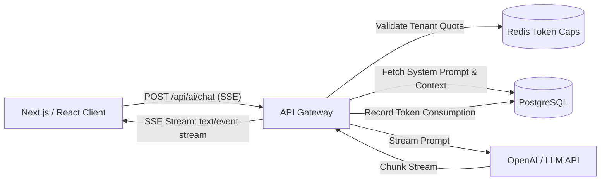

# Conversational AI Streaming & Governance

## Streaming Architecture (Server-Sent Events)

To provide instant conversational feedback while executing personalized business development coaching:

---

## Token Quota Governance

To ensure individual corporate tenants do not exceed contracted AI budgets:
1. **Atomic Token Tracking**: Redis atomic counters (`INCRBY` / `HINCRBY`) record cumulative daily and monthly prompt + completion tokens per tenant.
2. **Pre-flight Budget Guard**: Before dispatching incoming chat requests to external LLM endpoints, the API verifies that current tenant token balances remain below monthly subscription thresholds.
3. **Graceful Degradation**: If quotas are reached, users receive clear contextual notifications and are offered options for plan upgrades or cached responses.
