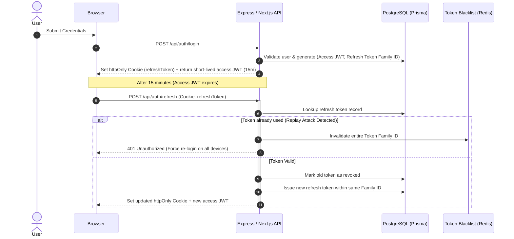

# Multi-Tenant Security & Session Architecture

## Cryptographic Refresh-Token Rotation

To prevent replay attacks and safeguard long-lived sessions without requiring frequent re-authentication:



---

## Tenant Data Isolation

All Prisma database queries pass through an organization tenant middleware wrapper:

```typescript
// Sanitised conceptual implementation pattern
export async function withTenantContext<T>(
  tenantId: string,
  operation: (prisma: PrismaClient) => Promise<T>
): Promise<T> {
  if (!tenantId) throw new Error("Tenant context missing");
  // Enforce tenant scoping automatically on all nested relations
  return operation(prisma.$extends({
    query: {
      $allModels: {
        async findMany({ args, query }) {
          args.where = { ...args.where, tenantId };
          return query(args);
        },
      },
    },
  }));
}
```
