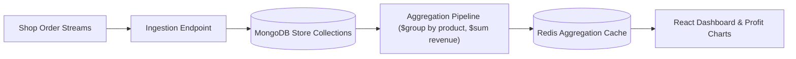

# Case Study: E-Commerce Seller Analytics & Growth Platform

## Domain & Problem Overview

E-commerce and TikTok Shop merchants require real-time visibility into net profit margins after accounting for advertising costs, marketplace fees, shipping overheads, and product returns. This platform provides subscription-based seller research tools, product profitability calculators, and revenue analytics.

---

## Architectural Highlights

- **MongoDB Aggregation Pipelines**: Multi-stage aggregation pipelines (`$match`, `$group`, `$facet`, `$project`) aggregating store transaction data across product catalogs.
- **Stripe Subscription Lifecycle**: Handling recurring billing, tiered seat plans, trial periods, and webhook event processing (`invoice.payment_succeeded`, `customer.subscription.deleted`).
- **Real-Time Margin Calculators**: Client-side reactive calculator tools enabling sellers to model pricing scenarios against estimated ad spend and shipping fees.

