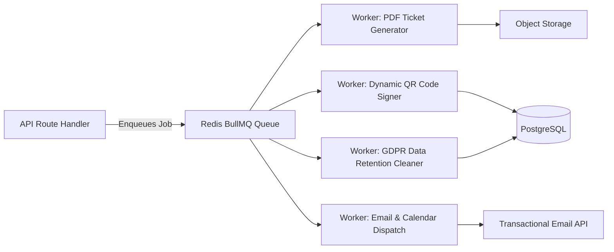

# Architecture & System Design: Multi-Tenant Event Platform

## Multi-Tenant Routing Strategy

To support arbitrary custom domains and subdomain structures for different events without deploying separate infrastructure instances:

1. **Host Header Resolution**: Edge middleware inspects the incoming `Host` header (e.g., `event2026.com` or `org.platform.com/event`).
2. **Tenant Context Injection**: A fast Redis lookup maps the host to the canonical `tenant_id` and `event_id`. This context is attached to the request lifecycle.
3. **Database Scoping**: All SQL queries via the persistence layer enforce row-level scoping (`WHERE tenant_id = $1 AND event_id = $2`) or execute under isolated tenant schemas.

---

## Asynchronous Worker Topology (BullMQ + Redis)

High-latency tasks are offloaded from synchronous HTTP request lifecycles to background queues:

---

## Applied AI Integration via Model Context Protocol (MCP)

To power the in-app attendee assistant:
- **Model Context Protocol (MCP)**: Custom MCP server exposing read-only tool contracts (`lookup_agenda`, `find_speaker`, `venue_directions`, `check_ticket_status`).
- **Dynamic Model Routing**: Lightweight intent classifier routes query complexity between Google Gemini (latency-sensitive factual lookups) and Claude / OpenAI (complex contextual recommendations).
- **Prompt Injection Hardening & Token Budgeting**: Strict input sanitization and per-tenant daily token consumption quotas enforced in Redis.
