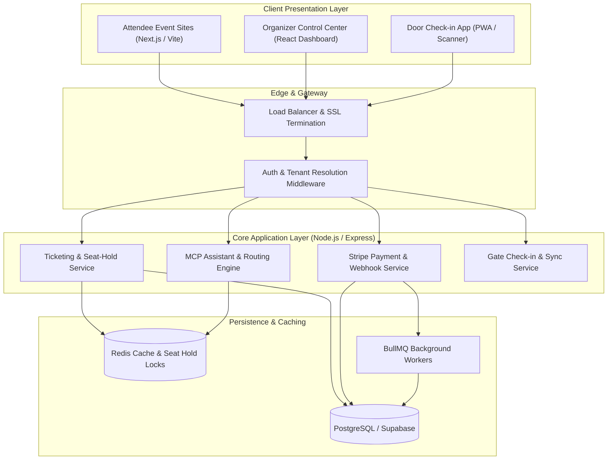

# Case Study: Multi-Tenant Event & Conference Platform

## Domain & Problem Overview

Modern conference and event ecosystems require serving thousands of concurrent attendees across multiple independent event websites, while providing event organizers with a unified administrative control plane.

Key challenges addressed:
- **Multi-Brand Tenant Isolation**: Serving multiple distinct event domains from a shared API and centralized organizer dashboard.
- **High-Demand Ticketing Concurrency**: Preventing overselling during ticket release spikes when thousands of attendees attempt to reserve a finite number of seats simultaneously.
- **Day-of-Event Gate Operations**: Processing attendee check-in rapidly at physical venue gates, including degraded network connectivity conditions.
- **In-App Attendee Support**: Integrating multi-provider AI assistance without leaking organizer prompt data or exceeding per-event token budgets.

---

## High-Level Architecture

---

## Detailed Technical Documents

- **[System Architecture & Data Boundaries](./architecture.md)**: Database schema modeling, worker queue topologies, and multi-tenant routing.
- **[Ticketing, Payment & Check-in Flows](./ticketing-and-payment-flows.md)**: State-machine sequence diagrams for temporary seat holds, Stripe webhooks, and offline scanner sync.
