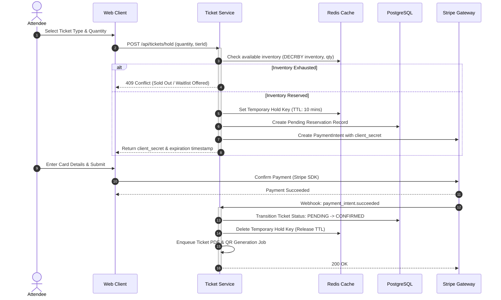

# Ticketing, Concurrency & Check-in Flows

## 1. Concurrency-Safe Seat Hold State Machine

To prevent ticket overselling while giving users sufficient time to complete checkout:

---

## 2. Dynamic QR Generation & Offline Door Check-in

For physical door operations:
1. **Cryptographically Signed QR Tokens**: QR codes encode a signed HMAC-SHA256 token containing `ticket_id`, `event_id`, and `nonce`.
2. **Offline Scanner Cache**: Gate scanner devices pre-fetch encrypted attendee manifests during initial sync.
3. **Optimistic Local Validation**: Scanners validate signatures locally in airplane/degraded mode, logging scanned nonces locally in IndexedDB.
4. **Reconnection Sync**: When network connectivity is restored, the scanner flushes its scan log to the API, reconciling check-in timestamps.
