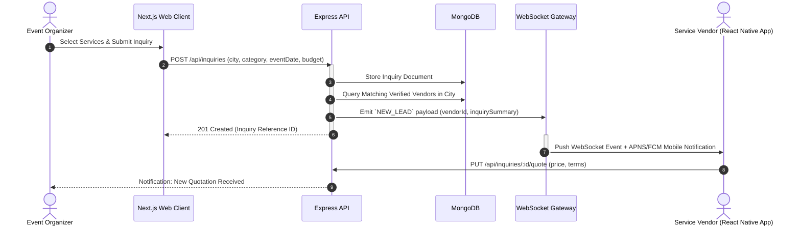

# Discovery Engine & Real-Time Lead Flow

## Real-Time Inquiry & Lead Dispatch Flow

When an event organizer submits a quotation request, it is processed and broadcast to relevant vendors instantly:

