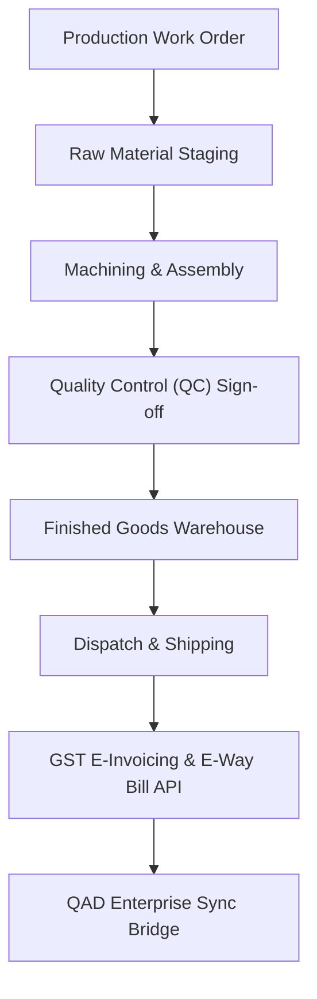

# Case Study: Manufacturing ERP & Shop-Floor Platform

## Domain & Problem Overview

Discrete manufacturing facilities require tracking raw materials from procurement to work-in-progress (WIP) assembly and finished goods warehousing. Legacy enterprise systems (such as QAD) often lack modern web interfaces, real-time stage approvals, and automated statutory e-invoicing capabilities.

---

## Architectural Highlights

- **Shop-Floor WIP State Engine**: Work order tracking tracking routing stages, machine assignments, and operator quality sign-offs.
- **Statutory E-Invoicing & E-Way Bill Integration**: Automated integration with Indian GST tax APIs for generating cryptographically signed Invoice Reference Numbers (IRN) and QR-code bills prior to goods transport.
- **Enterprise ERP Synchronization**: Bidirectional middleware adapters reconciling batch inventory movements with backend QAD enterprise databases.

