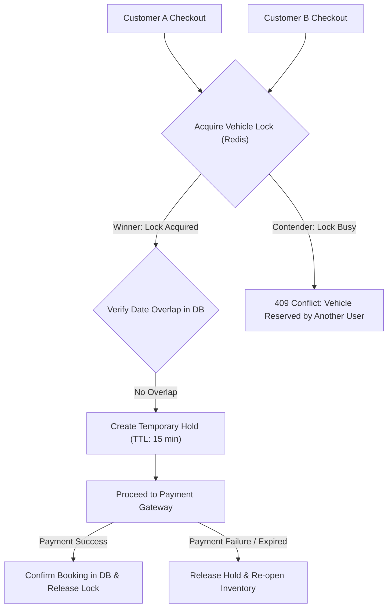

# Booking Concurrency & Double-Booking Mitigation

## The Overlapping Reservation Problem

When two users initiate checkout for Vehicle $V_1$ covering overlapping date ranges ($[T_{start_A}, T_{end_A}]$ and $[T_{start_B}, T_{end_B}]$):

---

## State Machine Transition Rules

1. `AVAILABLE`: Vehicle is open for search queries.
2. `HELD`: Customer has entered checkout. Redis key `hold:vehicle:{id}` exists with 15-minute TTL.
3. `BOOKED`: Payment succeeded. Confirmed booking record written to MongoDB with compound index on `(vehicleId, startDate, endDate)`.
4. `DISPATCHED`: Field staff has handed over the keys and logged initial odometer reading via Android app.
5. `RETURNED`: Inspection completed, final odometer and damage report logged, vehicle marked `AVAILABLE`.
